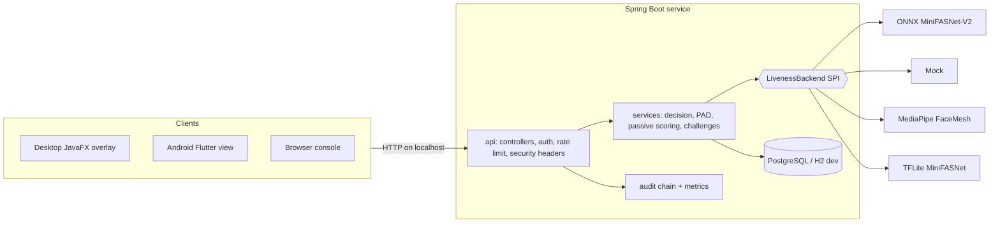
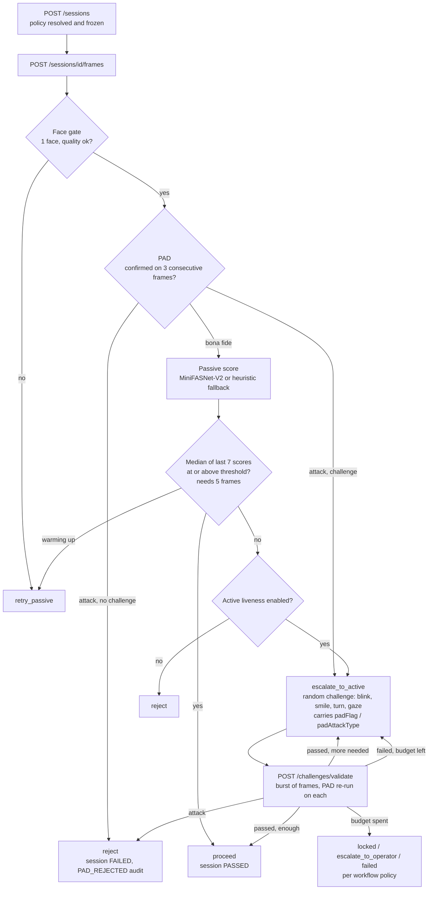

<div align="center">

# Face Liveliness Console

### Stop spoofs at the camera. Decide locally. Prove it later.

**Local-first face liveness and presentation attack detection (PAD) for the [MOSIP](https://mosip.io/) Registration Client.**
Passive scoring, randomised active challenges and a terminal PAD gate, decided on the capture host with **no network call on the decision path**.


[Quick start](#quick-start) · [How it works](#how-a-decision-is-made) · [API](#api-at-a-glance) · [Security](#security-model) · [Performance](#performance) · [Honest status](#honest-status) · [Docs](#documentation)

</div>

---

## The problem

A face matcher cannot tell a live person from a printed photo, a phone screen, a replayed video or a mask. MOSIP's Registration Client captures faces in the field, often on low-cost hardware and sometimes with no connectivity, so the liveness check has to run **locally, in real time, on the capture host**.

## The solution

This service sits above the capture device. A Registration Client streams decoded frames to it and gets back **one actionable verdict** per call: `proceed`, `retry_passive`, `escalate_to_active` or `reject`. It never returns a template or an image.

One interaction model covers all three MOSIP workflows:

| Workflow | Purpose |
|---|---|
| **Resident registration** | Verify a resident's face during ID enrolment |
| **Operator authentication** | Verify the operator signing in to the workstation |
| **Supervisor authentication** | Verify the supervisor approving registrations |

## At a glance

| | |
|---|---|
| **751** | passing Java tests, plus a Python reference suite and a console DOM harness |
| **~62 ms** | per frame at the scoring seam (ONNX, distinct frames), down from 161 ms |
| **12 KB** | per console frame upload (640 px, JPEG q0.7), down from 43 KB |
| **15.8 s** | median cold boot to `/health` on an idle 2-core host (budget 120 s) |
| **89 MiB** | slim jar (ceiling 110 MiB) |
| **4** | pluggable scoring backends behind one SPI |
| **0** | network calls on the decision path |

Every figure is measured and dated in [docs/performance-baseline.md](docs/performance-baseline.md), including the caveats.

## Highlights

| | |
|---|---|
| **Defence in depth** | PAD runs on every frame before scoring, then passive liveness, then a randomised active challenge only when passive is inconclusive |
| **PAD on every stage** | A confirmed attack is carried into the active challenge (`padFlag` / `padAttackType` on the escalation), where both the heuristics and MiniFASNet run on every frame and a hit is terminal. Only a workflow with no challenge stage rejects outright. The subject still sees only a generic message |
| **Median-window voting** | The passive decision is the median of the last 7 scores once 5 exist, so one blurry frame cannot escalate a session and one lucky frame cannot pass it |
| **Offline by design** | Only policy and model updates need connectivity |
| **Pluggable scoring** | One `LivenessBackend` SPI: mock, ONNX MiniFASNet-V2, MediaPipe FaceMesh, TFLite MiniFASNet. A vendor SDK drops in without touching the pipeline |
| **Per-role policy, frozen per session** | Resident, operator and supervisor each get their own operating point, snapshotted at session start so an edit cannot move an in-flight session |
| **Tamper-evident audit** | HMAC-SHA-256 hash-chained trail; PostgreSQL triggers block `UPDATE` and `DELETE` on `audit_logs` |
| **Account-based admin** | BCrypt accounts, `HttpOnly` session cookies, supervisor-gated policy writes, last-supervisor safeguard |
| **ISO/IEC 30107-3 tooling** | APCER/BPCER/ACER harness, per-attack-species APCER, threshold-sweep calibration endpoint |
| **Three client surfaces** | Browser console, JavaFX overlay and Flutter/Android view, all driven by the same states and message keys |

## Architecture



## How a decision is made



Design rules that matter:

- **PAD before scoring, and again on the challenge.** A spoof never gets to influence the liveness score, and a replay that the passive stage flagged cannot clear the flag by performing the action.
- **Fail closed.** An exception, timeout or missing model is a failure, never a skip.
- **Challenge lock.** While a challenge is open, every frame is answered with the same challenge, so a late high-score frame cannot pass the session without the action being performed.
- **Challenges are never user-selected.** `SecureRandom` shuffled bag, no back-to-back repeats.

## Quick start

**Requirements:** JDK 17+. The Maven wrapper is bundled, so no local Maven is needed.

```bash
./start.sh            # macOS / Linux / Git Bash
start.bat             # Windows
```

The launcher builds the jar, runs it on the `dev` profile (in-memory H2, no PostgreSQL), waits for `/health` and opens the console. It is a **developer** launcher: it never builds an installer.

| Way to run | Command | Needs | Produces |
|---|---|---|---|
| **Developer launcher** | `./start.sh` or `./run.sh`; `start.bat` or `run.bat` | JDK 17+ | The jar, then a local console on port 8000 |
| **Docker** | `docker compose up --build` | Docker | The API plus PostgreSQL in containers |
| **Installer** | `.deb`, `.rpm`, AppImage or `.exe` ([below](#install-as-a-service)) | Nothing, the JRE is bundled | An installed service with a menu or Start-menu entry |

The three paths are independent on purpose: the launchers never package, Docker never runs an installer, and an installed service never needs Maven or a JDK.

| Launcher option | Effect |
|---|---|
| `--no-build` / `--rebuild` | Skip Maven / clean build |
| `--port N` | Change the port (default `8000`) |
| `--lowmem` | JVM flags and profile for a 2-core / 2 GB host (see [Performance](#performance)) |
| `--no-browser`, `--test`, `--profile NAME`, `--help` | As named |

| URL | What |
|---|---|
| `http://localhost:8000/` | Browser test console (use `localhost`; browsers expose the camera only on a secure origin) |
| `http://localhost:8000/swagger-ui/index.html` | Interactive API docs |
| `http://localhost:8000/health` | Health, including whether the OpenCV engine loaded |

### Try the decision flow

```bash
BASE=http://localhost:8000

# 1. Open a session (policy is resolved and frozen here)
SESSION_ID=$(curl -s -X POST $BASE/api/v1/sessions \
  -H "Content-Type: application/json" \
  -d '{"workflowType":"RESIDENT","deviceId":"L1-CAM-01"}' \
  | python3 -c "import sys,json;print(json.load(sys.stdin)['id'])")

# 2. Stream frames (base64 JPEG). Keep going while action == retry_passive
curl -s -X POST $BASE/api/v1/sessions/$SESSION_ID/frames \
  -H "Content-Type: application/json" \
  -d "{\"frameBase64\":\"$(base64 -w0 face.jpg)\"}"

# 3. Only if action == escalate_to_active: submit the burst for the issued challenge
curl -s -X POST $BASE/api/v1/sessions/$SESSION_ID/challenges/validate \
  -H "Content-Type: application/json" \
  -d '{"challengeId":"<from step 2>","framesBase64":["<f1>","<f2>","<f3>"]}'

# 4. Close and read the audit trail
curl -s -X POST $BASE/api/v1/sessions/$SESSION_ID/close
curl -s $BASE/api/v1/sessions/$SESSION_ID/audit
```

### Production-style run (PostgreSQL)

```bash
cp .env.example .env              # set POSTGRES_PASSWORD, MOSIP_AUDIT_HMAC_SECRET, ...
docker compose up --build         # PostgreSQL 16 + the API
```

> **Container caveat.** The Docker image is Alpine (musl) and the OpenCV native is glibc-linked, so **frame processing is unavailable inside the container**. `/health` reports `status: ok` but not `engine: available`. The API, policy, audit, rate limiting and console all work. Run the **jar on a glibc host** when you need the engine.

### First supervisor and policy writes

On an empty database, set both bootstrap variables once. The account must change its password at first sign-in, and leaving the variables set afterwards is a no-op.

```bash
export MOSIP_AUTH_BOOTSTRAP_USERNAME=first-supervisor
export MOSIP_AUTH_BOOTSTRAP_PASSWORD='<at least 12 characters>'
export MOSIP_AUDIT_HMAC_SECRET=$(openssl rand -hex 32)   # >= 16 chars, keys the audit chain

# Sign in; the session arrives as an HttpOnly cookie, never in a body
curl -s -c jar.txt -X POST $BASE/api/v1/auth/login -H "Content-Type: application/json" \
  -d "{\"username\":\"$MOSIP_AUTH_BOOTSTRAP_USERNAME\",\"password\":\"$MOSIP_AUTH_BOOTSTRAP_PASSWORD\"}"

# Replace the bootstrap password (revokes the old session, issues a new cookie)
curl -s -b jar.txt -c jar.txt -X POST $BASE/api/v1/auth/change-password \
  -H "Content-Type: application/json" \
  -d '{"currentPassword":"<bootstrap password>","newPassword":"<a longer replacement>"}'

# Tune a threshold at runtime (SUPERVISOR session required; the edit is audited)
curl -s -b jar.txt -X PUT $BASE/api/v1/config/RESIDENT \
  -H "Content-Type: application/json" -d '{"passiveThreshold": 0.85}'
```

## Install as a service

### Linux installers

On Linux, `./mvnw package` also builds three installers next to the jar, in `target/dist/`:

| File | What it is |
|---|---|
| `pad-liveness_<version>-1_amd64.deb` | Service image under `/opt/pad-liveness` and a systemd unit; the postinst runs `systemctl daemon-reload` |
| `pad-liveness-<version>-1.x86_64.rpm` | The same payload and unit for Fedora/RHEL |
| `pad-liveness-<version>-x86_64.AppImage` | Self-contained; starts the service, waits for `/health`, then opens the console |

```bash
./mvnw package -DskipTests                 # jar + .deb + .rpm + AppImage
./mvnw package -DskipTests -Pslim          # same, from the linux-only jar (~90 MB less)
./mvnw package -DskipTests -Dlinux.package.skip=true   # jar only

sudo dpkg -i target/dist/pad-liveness_*_amd64.deb      # unit installed, not enabled
sudo systemctl enable --now pad-liveness
./target/dist/pad-liveness-*-x86_64.AppImage           # no install, no root
```

- All three start the **`dev` profile** (in-memory database), so they work with no PostgreSQL. For the real schema set `PAD_LIVENESS_PROFILE=prod` and provide the `POSTGRES_*` variables from [docs/configuration.md](docs/configuration.md).
- The packaged unit is sandboxed: `DynamicUser`, `NoNewPrivileges`, an empty capability set, `ProtectSystem=strict`, a `@system-service` syscall filter. It needs **systemd 247 and kernel 5.8 or newer**; an older host drops the newer directives silently, which is why CI boots the unit on Debian 11 and Ubuntu 22.04.
- Headless installs work: the repacked postinst tolerates `xdg-desktop-menu` failing where no desktop exists.
- Packaging is best-effort locally and strict in CI (`-Dlinux.package.strict=true` turns every skipped tool into a failure). Only Linux x86_64 is wired up.
- Tagged releases publish all installers beside the jars, each with a `.sha256` so `sha256sum -c` verifies a download in place. `scripts/release-assets.sh rehearse` exercises the publish path without a tag.

### Windows installer

| File | What it is |
|---|---|
| `pad-liveness-<version>.exe` | jpackage + WiX installer with a bundled JRE. Per-user install, no elevation, Start-menu entry under **MOSIP** plus a desktop shortcut |

```powershell
.\mvnw.cmd package -DskipTests                                # jar + .exe
.\mvnw.cmd package -DskipTests -Dwindows.package.skip=true    # jar only
```

- Needs **WiX Toolset 3.x** (jpackage does not support WiX 4/5). A missing toolchain skips the `.exe` with a warning; `-Dwindows.package.strict=true` makes it fatal, as in CI.
- **Build from the full jar, never `-Pslim`.** The slim profile keeps Linux natives only, so the installer would start and then report the engine unavailable. The packaging script refuses a slim jar.
- The build is **not code signed**, so SmartScreen warns on first run. Sign it before distributing outside your team.

### Android harness APK

A `v*` tag also publishes `pad-liveness-android-harness-<version>.apk` with a `.sha256`, built from [`android_client/`](android_client/README.md).

**It is not the MOSIP Registration Client and not a service installer.** It is the Flutter/Android integration harness: it installs and opens, but sessions fail closed until a host registers the native liveness API and camera pipeline. Read [android_client/README.md](android_client/README.md) before treating it as more than a host-integration artifact.

```bash
adb install pad-liveness-android-harness-<version>.apk   # debug-signed, sideload only
```

The release build is signed with the debug key, so it is not store-ready. To build it locally, follow the pinned Flutter toolchain in [android_client/README.md](android_client/README.md) and run `flutter build apk --release` from that directory. <!-- boundary-allow: the Flutter command documents the android_client harness, not the Maven service -->

## Per-role policy

The user type is set once, at session creation, and that workflow's policy is **frozen on the session**. A signed-in caller does not choose it: the account's role decides, and a request naming a different type is refused with `403`, so staff authentication cannot be measured against the resident policy. An anonymous caller (the resident capture) names it in the request. A later `PUT /api/v1/config/{workflow}` affects only new sessions.

| Workflow | Passive threshold | Challenges required | Challenge window | Retry budget | On budget exhausted |
|---|---|---|---|---|---|
| `RESIDENT` | 0.80 | 1 | 20 s | 3 | `ESCALATE_TO_OPERATOR` |
| `OPERATOR` | 0.82 | 1 | 15 s | 2 | `FALLBACK` (new session allowed) |
| `SUPERVISOR` | 0.85 | 2 | 15 s | 1 | `LOCK_OUT` |

A resident may be physically assisted by an officer, so a failed resident check escalates to an operator. Operator and supervisor authentication never escalate to an operator. These are starting points: calibrate them on real hardware with the sweep endpoint.

## API at a glance

28 routes in four disjoint tiers, all under `/api/v1` except `/health`. The contract is in [docs/PRD.md](docs/PRD.md#7-api-reference), [docs/api-documentation.json](docs/api-documentation.json) and the live Swagger UI.

| Tier | Auth | Endpoints |
|---|---|---|
| **Client-facing** | none; session routes honour `X-Subject-Ref` ownership | `POST /sessions` · `GET /sessions/{id}` · `POST …/frames` · `POST …/challenges/validate` · `POST …/active-liveness` · `POST …/evidence` · `POST …/close` · `GET …/audit` · `GET /config/{workflow}` and `/effective` · `GET /config/audit` and `/audit/verify` · `GET /metrics` · `GET /diagnostics` (loopback, opt-in) · `GET /health` · `POST /auth/login` |
| **Authenticated** | session cookie or `Bearer` | `GET /auth/me` · `POST /auth/change-password` · `POST /auth/logout` |
| **Operator-keyed** | `X-Operator-API-Key` or an operator/supervisor session | `GET /auth/role` · `GET /sessions` (feed) · `GET /rejections` |
| **Supervisor-only** | `SUPERVISOR` session, fail-closed | `PUT /config/{workflow}` · `GET /eval/threshold-sweep` · `GET/POST/PUT/DELETE /users` |

Every error is `{"error", "message", "status", "timestamp"}`. Stack traces and exception text are never returned, and PAD failures show only a generic message.

## Security model

- **Fail-closed admin surface.** Policy writes, threshold sweeps and user management need a `SUPERVISOR` session: no session is `401`, a smaller role is `403`. Each policy edit is attributed to a named account and risk-classified (`HIGH` when it lowers the threshold or disables a check).
- **Tokens never rest in the clear.** 256-bit CSPRNG token, delivered once in an `HttpOnly; SameSite=Lax` cookie and stored only as a SHA-256 digest. Every sign-in failure is one generic `401`, and an unknown username still pays a full BCrypt verification, so the endpoint is neither a username nor a timing oracle.
- **Keyed audit chain.** HMAC-SHA-256 under a secret held outside the database, so an attacker with database write access cannot rebuild history. `GET /config/audit/verify` reports `hmac: true/false` so the weaker unkeyed mode is never mistaken for the keyed one.
- **Abuse resistance.** Per-IP limits on session creation, sign-in and operator-key attempts; a per-session frame budget; trusted-proxy-aware client IPs; a 24 MiB body cap; frame byte, dimension and pixel caps.
- **Strict headers.** Self-only CSP, `nosniff`, `X-Frame-Options: DENY`, `Referrer-Policy: no-referrer`, `Permissions-Policy`.
- **Privacy.** Responses carry derived signals only. Frames are never persisted, and metrics are anonymised aggregates.
- **Session ownership.** A session created with `subjectRef` answers only callers presenting it in `X-Subject-Ref`. This isolates honest clients from each other and is **not** authentication, so keep the service on loopback or behind the host's authenticated transport.
- **Injection attacks** (virtual camera, hooked camera API, frame replay) are modelled as a separate threat class with layered countermeasures and explicit residual risk in [docs/design.md](docs/design.md).

## Evaluation and ISO/IEC 30107

The `io.mosip.liveness.eval` harness reports **APCER, BPCER and ACER**, with APCER broken out per presentation-attack-instrument species (printed photo, screen replay, video replay). `GET /api/v1/eval/threshold-sweep` evaluates the same median-window decision the live path uses and recommends the strictest threshold within a BPCER budget. APCER is reported as `null`, never a fabricated zero, when no attack data exists.

> **This is not a certified PAD.** The repository ships methodology and tooling. The bundled MiniFASNet-V2 model is a reference integration, and self-testing is not certification. Attack data is a **proxy corpus** (simulated degradations, labelled `attackDataIsProxy: true`) until real print, screen and replay captures exist. Replace the reference scorer with a properly evaluated model or vendor SDK, and re-measure thresholds on real capture hardware, before making production claims.

## Performance

Measured, not estimated. Host: Intel Core i3-1005G1 (2 cores / 4 threads), 7.7 GiB RAM, OpenJDK 17, ONNX backend, `dev` profile. The target hardware is **2 cores / 2 GB**, so treat these as a comparable baseline, not a guarantee. Method and caveats: [docs/performance-baseline.md](docs/performance-baseline.md).

| Metric | Result |
|---|---|
| Cold boot to `/health` (median of 5, cold OpenCV cache) | **15.8 s** idle; 58.3 s when the host was under load (budget 120 s) |
| Slim jar / full jar | **89.4 MiB** / 200.7 MiB (ceilings 110 / 245) |
| Per-frame cost at the SPI, distinct frames | **61.8 ms** mean, about 16 fps (was 160.9 ms) |
| Per-frame pipeline over HTTP, distinct payloads | **167.8 ms** server-side (was 304.7 ms) |
| Console frame payload | **12 KB** (was 42.9 KB): 640 px long edge, JPEG q0.7, 8 frames/s ceiling |
| `--lowmem` on 2 pinned cores | boot 23.1 s to 19.0 s, RSS 314 MB to 277 MB |

The speedup came from removing duplicated work: one frame used to pay three Haar detections and two inferences, and now pays one of each. Returned values are bit-identical, and a test pins that.

The capture-budget change trades margin for cost. On one fixture the passive score moved from 0.9495 to 0.8555, still above the 0.80 threshold, with decision fields unchanged. That trade-off is documented rather than hidden.

## Pluggable backends

Everything depends on one seam, selected by the single key `mosip.liveness.backend`.

```java
String id();
void initialize(Map<String, String> options);
FaceSignals analyzeFrame(Frame frame);
double scorePassiveLiveness(Frame frame, FaceSignals signals);
PadVerdict assessPad(Frame frame, FaceSignals signals);
void shutdown();
```

| Backend | Notes |
|---|---|
| `onnx-minifasnet-v2` | **The `auto` default on the HTTP scoring path.** Bundled 1.7 MB model, SHA-256 verified on load; live class is output index 1; input is raw 0–255 BGR |
| `mock` | Scripted and deterministic, for CI and the attack harness; also the SPI bean under `auto` and `heuristic` |
| `mediapipe-facemesh` | 468-point landmarks. Needs the TFLite runtime and model, which are not bundled |
| `tflite-minifasnet` | Android and embedded only; the TFLite runtime has no desktop-JVM interpreter |

Explicit backends never silently fall back: an unavailable one fails closed with a coded error, and an unknown value stops startup. The seam is verified by a shared contract test across backends; see [docs/backend-swapping.md](docs/backend-swapping.md) and the measured [interoperability report](docs/backend-interoperability-report.md).

## Client surfaces

One state machine drives every surface, and all render the same states and i18n message keys.

- **Browser console** (`src/main/resources/static/`): plain JS with no build step, a dark-mode-aware design system, role-aware entry tab, an in-page credential dialog for all three roles, and a diff-aware policy editor. The screen never asserts what it has not read: unknown values say `UNKNOWN`, and placeholders are tagged `SAMPLE`.
- **Desktop (JavaFX):** `LivenessChallengeOverlay` (FXML + CSS), smoke-tested headlessly on Monocle.
- **Android (Flutter):** `LivenessView` over a Pigeon bridge, a CameraX frame source, a keystore-backed evidence signer and signed model manifests.
- **No technical exposure.** The UI shows generic, localised messages only. Scores, PAD detail and model internals live in the audit trail.

## Repository layout

| Path | What it is |
|---|---|
| `src/`, `pom.xml` | **The active codebase.** Spring Boot service and shared engine (190 main classes, 88 test classes, 751 tests) |
| `android_client/` | Pinned Flutter 3.10.4 / Dart 3.0.3 harness, Pigeon bindings, CameraX source. Not the full Registration Client |
| `pad_liveness_backend/` | Independent FastAPI + PostgreSQL reference implementation (Python 3.12, Alembic), not wired into the Java build <!-- boundary-allow: repository map names each sibling project's own stack --> |
| `training/` | Workstation-only synthetic-data pipeline for MiniFASNet. No real faces, not in CI |
| `docs/` | Cross-project documentation ([index](#documentation)) |
| `packaging/` | Inputs to the desktop installers: Linux icon, AppRun, desktop entry, systemd unit; Windows `.ico` |
| `scripts/` | Repo gates: secret scan, launchers, boundary and doc-link checks, Java import and package layout, jar smoke, jar size, cold-boot median, Docker, Windows-launcher and Linux-installer smoke |

Inside `io.mosip.liveness`: `api/` (controllers and filters), `auth/`, `services/`, `engine/` (embedded state machine), `backend/` (the SPI), `challenge/`, `config/`, `audit/`, `device/` (SBI stream, burst capture, mock L0/L1 device), `eval/`, `client/` and `android/`.

## Testing and CI

```bash
./mvnw --batch-mode test                         # Java unit + integration (88 test classes, 751 tests)
node src/test/js/console-guards.test.mjs        # console DOM guards, no Maven needed
node scripts/check-launchers.mjs                # developer launchers never build installers
node scripts/check-project-boundaries.mjs       # docs-vs-CI consistency gate
node scripts/check-doc-links.mjs                # every relative doc link and #anchor resolves
node scripts/check-java-imports.mjs             # every Java import resolves to source
node scripts/check-java-packages.mjs            # every package declaration matches its directory
cd pad_liveness_backend && python -m pytest -q   # 49 Python tests — boundary-allow: sibling project's suite, documented from the repository root
```

CI covers unit and integration suites, the console DOM guards, launcher guards, project boundaries, documentation links, Java source layout, secret scanning, the Python backend, a cross-backend contract test, the Android client, slim and full packaging (the jar's `BOOT-INF/lib` compared with the resolved runtime classpath, then booted), the Windows launcher and installer, the Docker image, the Linux installers, a 5-boot cold-boot budget, PostgreSQL schema validation via Testcontainers, and tagged releases that ship jars, installers and `.sha256` files.

Gates live outside Maven on purpose: a green Java suite says nothing about the console, packaging, boot time or the Windows launcher.

## Configuration essentials

Everything is overridable by environment variable. Full reference: [docs/configuration.md](docs/configuration.md).

| Variable | Default | Purpose |
|---|---|---|
| `POSTGRES_PASSWORD` | **required** (default profile) | Database password. Never commit it |
| `MOSIP_AUDIT_HMAC_SECRET` | empty | Keys the audit chain, minimum 16 chars. Blank falls back to plain SHA-256, which is tamper-*detecting* only |
| `MOSIP_AUTH_BOOTSTRAP_USERNAME` / `_PASSWORD` | empty | First supervisor on an empty database; password at least 12 chars |
| `MOSIP_OPERATOR_API_KEY` | blank (operator routes refuse everyone) | Read-only operator feeds, minimum 16 chars |
| `MOSIP_AUTH_COOKIE_SECURE` | `false` | Set `true` behind TLS |
| `SERVER_PORT` | `8000` | HTTP port |
| `mosip.liveness.backend` | `auto` | Scoring backend selection |
| `mosip.liveness.passive-threshold` | `0.80` | Calibrate with the sweep endpoint |
| `LIVENESS_DIAGNOSTICS_ENABLED` | `false` | Loopback-only diagnostics, identical `404` otherwise |

Use synthetic values in examples, and keep live keys and real biometrics out of source, tests, logs and docs.

## Honest status

A liveness service that overclaims is worse than none, so this is stated plainly.

| Status | What |
|---|---|
| **Implemented and gated** | The passive → PAD → active pipeline, per-role frozen policy, audit chain, accounts and roles, rate limiting, the SPI and four backends, the console, the evaluation harness, the Android build harness, packaging and CI |
| **Assumed** | Host integration against a real MOSIP Registration Client; behaviour on real L0/L1 vendor hardware |
| **Gap** | A physical presentation-attack corpus; a device matrix and on-device benchmarks (including the Android optimisation and acceleration work); a certified or field-evaluated PAD model |

Also open:

- Compromised-camera injection is outside ISO/IEC 30107 scope. The residual risk is documented, not eliminated.
- Compliance items still open: the operator/supervisor face-auth assumption (MOSIP docs describe username/password), the Android SBI intent transport (blocked on a vendor answer) and the desktop 4501–4600 discovery scan. See [docs/resource-compliance.md](docs/resource-compliance.md).
- The Java (0.80) and Python (0.75) default thresholds differ. Align them deliberately before treating the services as interchangeable.
- Audit-chain key rotation has no re-key operation, so the previous secret must stay configured while historical hashes need it.

## Documentation

| Document | Covers |
|---|---|
| [docs/PRD.md](docs/PRD.md) | Product requirements and full system reference |
| [docs/design.md](docs/design.md) | Architecture, frame pipeline, ISO alignment, injection threat model |
| [docs/configuration.md](docs/configuration.md) | Policy, audit chain, accounts and roles, `--lowmem` |
| [docs/client-integration-guide.md](docs/client-integration-guide.md) | Wiring the Desktop and Android Registration Clients |
| [docs/ui-ux-design.md](docs/ui-ux-design.md) | Interaction model, message catalogue, console design system |
| [docs/backend-swapping.md](docs/backend-swapping.md) | Replacing the scorer, including licensed SDKs |
| [docs/backend-interoperability-report.md](docs/backend-interoperability-report.md) | Measured mock / ONNX / MediaPipe comparison |
| [docs/performance-baseline.md](docs/performance-baseline.md) | Measured boot, memory, latency and payload numbers |
| [docs/resource-compliance.md](docs/resource-compliance.md) | Audit against ISO 30107-1/-3, ISO 19794-5 and the MOSIP specs |
| [docs/acceptance-audit.md](docs/acceptance-audit.md) | Task checklist against the implementation |
| [docs/status-report.md](docs/status-report.md) | Delivery status and real-model feasibility findings |
| [docs/known-quirks.md](docs/known-quirks.md) | Behaviours that look like bugs |
| [docs/jackson-3.md](docs/jackson-3.md) | Jackson 3 rules: packages, immutable mappers, the shared annotation API |
| [docs/brain.md](docs/brain.md) | Long-form codebase walkthrough |
| [docs/api-documentation.json](docs/api-documentation.json) | Machine-readable API documentation |

## Contributing

Keep a public contract and its documentation in sync in the same change, never weaken a check to make it pass, and run `node scripts/check-project-boundaries.mjs` after editing guidance, a README or a workflow. Per-project `AGENTS.md` files are authoritative for how to change each project.

JSON goes through Jackson 3 (`tools.jackson`). Before adding a mapper or importing anything from `com.fasterxml.jackson`, read [docs/jackson-3.md](docs/jackson-3.md): the Jackson 2 jars are on the classpath for springdoc's sake, so a wrong import compiles and then fails at runtime.

## Context

Built for MOSIP Problem Statement 04, *Face Liveness Detection and Presentation Attack Detection*.

## License

<!-- TODO: add a LICENSE file and state it here before publishing. -->
Third-party: the bundled MiniFASNet-V2 model is Apache-2.0.
