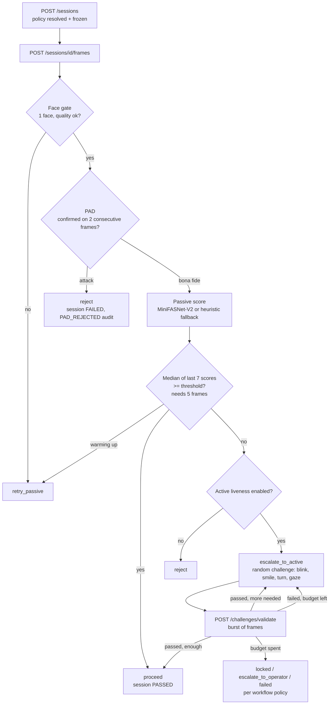

<div align="center">

# Face Liveliness Console

**Local-first face liveness and presentation attack detection for the [MOSIP](https://mosip.io/) Registration Client.**
Passive scoring, active challenges and a terminal PAD gate, decided on the capture host with no network call on the decision path.


</div>

---

## Why this exists

A face matcher cannot tell a live person from a printed photo, a phone screen, a replayed video or a mask. MOSIP's Registration Client captures faces in the field, often on low-cost hardware and sometimes with no connectivity, so the liveness check has to run **locally, in real time, on the capture host**.

This service sits above the capture device. A Registration Client streams decoded frames to it, and it returns one actionable verdict: `proceed`, `retry_passive`, `escalate_to_active` or `reject`. It never returns a template or an image.

It covers all three MOSIP workflows with one interaction model:

| Workflow | Purpose |
|---|---|
| **Resident registration** | Verify a resident's face during ID enrolment |
| **Operator authentication** | Verify the operator signing in to the workstation |
| **Supervisor authentication** | Verify the supervisor approving registrations |

## Highlights

| | |
|---|---|
| **Defence in depth** | PAD runs on every frame before scoring, then passive liveness, then a randomised active challenge only when passive is inconclusive |
| **Terminal PAD** | A confirmed attack ends the session. No retry, a distinct audit event, and only a generic message shown to the user so attackers learn nothing |
| **Median-window voting** | The passive decision is the median of the last 7 scores once 5 exist, so one blurry frame cannot escalate a session and one lucky frame cannot pass it |
| **Offline by design** | No network call anywhere on the decision path. Only policy and model updates need connectivity |
| **Pluggable scoring** | One SPI (`LivenessBackend`) with four implementations: mock, ONNX MiniFASNet-V2, MediaPipe FaceMesh and TFLite MiniFASNet. A vendor SDK drops in without touching the pipeline |
| **Per-role policy, frozen per session** | Resident, operator and supervisor each get their own operating point, resolved and snapshotted at session start so an edit cannot move an in-flight session |
| **Tamper-evident audit** | HMAC-SHA-256 hash-chained audit trail, with PostgreSQL triggers blocking `UPDATE`/`DELETE` on `audit_logs` |
| **Account-based admin** | BCrypt accounts, `HttpOnly` session cookies, supervisor-gated policy writes and a last-supervisor safeguard. The shared admin key is gone |
| **ISO/IEC 30107-3 tooling** | APCER/BPCER/ACER harness with per-attack-species APCER and a threshold-sweep calibration endpoint |
| **Three client surfaces** | Browser console, JavaFX desktop overlay and Flutter/Android view, all driven by the same state machine and message keys |

## How a decision is made



## Quick start

**Requirements:** JDK 17+ (the Maven wrapper is bundled, no local Maven needed).

```bash
./start.sh            # macOS / Linux / Git Bash
start.bat             # Windows
```

The launcher builds the jar, runs it on the `dev` profile (in-memory H2, no PostgreSQL needed), waits for `/health` and opens the console.

| Option | Effect |
|---|---|
| `--no-build` / `--rebuild` | Skip Maven / clean build |
| `--port N` | Change the port (default `8000`) |
| `--lowmem` | JVM flags and profile for a 2-core / 2 GB host (see [Performance](#performance)) |
| `--no-browser`, `--test`, `--profile NAME`, `--help` | As named |

| URL | What |
|---|---|
| `http://localhost:8000/` | Browser test console (use `localhost`; browsers only expose the camera on a secure origin) |
| `http://localhost:8000/swagger-ui/index.html` | Interactive API docs |
| `http://localhost:8000/health` | Health, including whether the OpenCV engine loaded |

### Try the decision flow

```bash
BASE=http://localhost:8000

# 1. Open a session (policy is resolved and frozen here)
SESSION_ID=$(curl -s -X POST $BASE/api/v1/sessions \
  -H "Content-Type: application/json" \
  -d '{"workflowType":"RESIDENT","deviceId":"L1-CAM-01"}' \
  | python3 -c "import sys,json;print(json.load(sys.stdin)['id'])")

# 2. Stream frames (base64 JPEG). Keep going while action == retry_passive
curl -s -X POST $BASE/api/v1/sessions/$SESSION_ID/frames \
  -H "Content-Type: application/json" \
  -d "{\"frameBase64\":\"$(base64 -w0 face.jpg)\"}"

# 3. Only if action == escalate_to_active: submit the burst for the issued challenge
curl -s -X POST $BASE/api/v1/sessions/$SESSION_ID/challenges/validate \
  -H "Content-Type: application/json" \
  -d '{"challengeId":"<from step 2>","framesBase64":["<f1>","<f2>","<f3>"]}'

# 4. Close and read the audit trail
curl -s -X POST $BASE/api/v1/sessions/$SESSION_ID/close
curl -s $BASE/api/v1/sessions/$SESSION_ID/audit
```

### Production-style run (PostgreSQL)

```bash
cp .env.example .env              # set POSTGRES_PASSWORD, MOSIP_AUDIT_HMAC_SECRET, ...
docker compose up --build         # PostgreSQL 16 + the API
```

> **Container caveat.** The Docker image is Alpine (musl) and the OpenCV native is glibc-linked, so **frame processing is unavailable inside the container**. `/health` reports `status: ok` but not `engine: available`. The API, policy, audit, rate limiting and console all work. Run the **jar on a glibc host** when you need the engine.

### First supervisor and policy writes

On an empty database, set both bootstrap variables once. The account must change its password at first sign-in, and leaving the variables set afterwards is a no-op.

```bash
export MOSIP_AUTH_BOOTSTRAP_USERNAME=first-supervisor
export MOSIP_AUTH_BOOTSTRAP_PASSWORD='<at least 12 characters>'
export MOSIP_AUDIT_HMAC_SECRET=$(openssl rand -hex 32)   # >= 16 chars, keys the audit chain

# Sign in; the session arrives as an HttpOnly cookie, never in a body
curl -s -c jar.txt -X POST $BASE/api/v1/auth/login -H "Content-Type: application/json" \
  -d "{\"username\":\"$MOSIP_AUTH_BOOTSTRAP_USERNAME\",\"password\":\"$MOSIP_AUTH_BOOTSTRAP_PASSWORD\"}"

# Replace the bootstrap password (revokes the old session, issues a new cookie)
curl -s -b jar.txt -c jar.txt -X POST $BASE/api/v1/auth/change-password \
  -H "Content-Type: application/json" \
  -d '{"currentPassword":"<bootstrap password>","newPassword":"<a longer replacement>"}'

# Tune a threshold at runtime (SUPERVISOR session required; the edit is audited)
curl -s -b jar.txt -X PUT $BASE/api/v1/config/RESIDENT \
  -H "Content-Type: application/json" -d '{"passiveThreshold": 0.85}'
```

## Per-role policy

The user type is chosen once, at session creation, and that workflow's policy is frozen on the session. A later `PUT /api/v1/config/{workflow}` affects only new sessions.

| Workflow | Passive threshold | Challenges required | Challenge window | Retry budget | On budget exhausted |
|---|---|---|---|---|---|
| `RESIDENT` | 0.80 | 1 | 20 s | 3 | `ESCALATE_TO_OPERATOR` |
| `OPERATOR` | 0.82 | 1 | 15 s | 2 | `FALLBACK` (new session allowed) |
| `SUPERVISOR` | 0.85 | 2 | 15 s | 1 | `LOCK_OUT` |

A resident may be physically assisted by an officer, so a failed resident check escalates to an operator. Operator and supervisor authentication never escalate to an operator. They fail or retry. The defaults are starting points. Calibrate them on real hardware.

## API at a glance

All session routes live under `/api/v1`. The full contract is in [docs/PRD.md](docs/PRD.md) §7 and the live Swagger UI.

| Tier | Auth | Endpoints |
|---|---|---|
| **Client-facing** | none (session routes honour `X-Subject-Ref` ownership) | `POST /sessions` · `GET /sessions/{id}` · `POST /sessions/{id}/frames` · `POST /sessions/{id}/challenges/validate` · `POST /sessions/{id}/active-liveness` · `POST /sessions/{id}/close` · `GET /sessions/{id}/audit` · `GET /config/{workflow}` and `/effective` · `GET /config/audit` and `/audit/verify` · `GET /metrics` · `GET /diagnostics` (loopback, opt-in) · `GET /health` |
| **Authenticated** | session cookie or `Bearer` | `GET /auth/me` · `POST /auth/change-password` · `POST /auth/logout` |
| **Operator-keyed** | `X-Operator-API-Key` or an operator/supervisor session | `GET /auth/role` · `GET /sessions` (feed) · `GET /rejections` |
| **Supervisor-only** | `SUPERVISOR` session, fail-closed | `PUT /config/{workflow}` · `GET /eval/threshold-sweep` · `GET/POST/PUT/DELETE /users` |

Every error is `{"error", "message", "status", "timestamp"}`. Stack traces and exception text are never returned, and PAD failures show only a generic message.

## Security model

- **Fail-closed admin surface.** Policy writes, threshold sweeps and user management need a `SUPERVISOR` session. No session gives `401`, a smaller role gives `403`. Each policy edit is attributed to a named account and risk-classified (`HIGH` when it lowers the threshold or disables a check).
- **Tokens never rest in the clear.** 256-bit CSPRNG token, delivered once in an `HttpOnly; SameSite=Lax` cookie and stored only as a SHA-256 digest. Sign-in failures are one generic `401`, and an unknown username still pays a full BCrypt verification, so the endpoint is neither a username nor a timing oracle.
- **Keyed audit chain.** Hashes are HMAC-SHA-256 under a secret held outside the database, so an attacker with database write access cannot rebuild history. `GET /config/audit/verify` reports `hmac: true/false`, so the weaker unkeyed mode is never mistaken for the keyed one.
- **Abuse resistance.** Per-IP session-create, sign-in and operator-key limits plus a per-session frame budget, with trusted-proxy-aware client IPs. A 24 MiB body cap and frame byte, dimension and pixel caps apply.
- **Strict headers.** Strict self-only CSP, `nosniff`, `X-Frame-Options: DENY`, `Referrer-Policy: no-referrer` and `Permissions-Policy`.
- **Privacy.** Responses carry derived signals only. Frames are never persisted, and metrics are anonymised aggregates.
- **Session ownership.** A session created with `subjectRef` answers only callers presenting it in `X-Subject-Ref`. This isolates honest clients from each other and is **not** authentication, so keep the service on loopback or behind the host's authenticated transport.
- **Injection attacks** (virtual camera, hooked camera API, frame replay) are modelled as a separate threat class with layered countermeasures and explicit residual risk in [docs/design.md](docs/design.md) §6.

## Evaluation and ISO/IEC 30107

The `io.mosip.liveness.eval` harness reports **APCER, BPCER and ACER**, with APCER broken out per presentation-attack-instrument species (printed photo, screen replay, video replay). `GET /api/v1/eval/threshold-sweep` evaluates the same median-window decision the live path uses and recommends the strictest threshold within a BPCER budget. APCER is reported as `null`, never a fabricated zero, when no attack data exists.

> **This is not a certified PAD.** The repository ships methodology and tooling. The bundled MiniFASNet-V2 model is a reference integration, and self-testing is not certification. Attack data is a **proxy corpus** (simulated degradations, labelled `attackDataIsProxy: true`) until real print, screen and replay captures exist. Replace the reference scorer with a properly evaluated model or vendor SDK, and re-measure thresholds on real capture hardware, before making production claims.

## Performance

Measured, not estimated. Host: Intel Core i3-1005G1 (2 cores / 4 threads), 7.7 GiB RAM, OpenJDK 17, ONNX backend, `dev` profile, and a **busy shared machine**. Target hardware is 2 cores / 2 GB, so treat these as a baseline for comparison, not a guarantee. Method and caveats are in [docs/performance-baseline.md](docs/performance-baseline.md).

| Metric | Result |
|---|---|
| Cold boot to `/health` (median of 5, cold OpenCV cache) | **58.3 s** (budget 120 s) |
| Slim jar / full jar | **89.4 MiB** / 200.7 MiB (ceilings 110 / 245) |
| Per-frame cost at the SPI, distinct frames | **61.8 ms** mean, ~16 fps (was 160.9 ms before the one-detection-one-inference fix) |
| Per-frame pipeline over HTTP, distinct payloads | **167.8 ms** server-side (was 304.7 ms) |
| Console frame payload | **12 KB** per frame (was 42.9 KB): 640 px long edge, JPEG q0.7, 8 frames/s ceiling |
| `--lowmem` on 2 pinned cores | boot 23.1 s → 19.0 s, RSS 314 MB → 277 MB |

The capture-budget change reduces margin as well as cost. On one fixture the passive score fell from 0.9495 to 0.8555, still above the 0.80 threshold, with decision fields unchanged. That trade-off is documented rather than hidden.

## Console and client UX

One state machine drives every surface, and all of them render the same states and the same i18n message keys.

- **Browser console** (`src/main/resources/static/`): plain JS with no build step, a "modern institutional" design system with a dark palette, a role-aware entry tab (supervisor → Policy, operator → Sessions), an in-page credential dialog (no `window.prompt`) and a diff-aware policy editor. The screen never asserts what it has not read: unknown values say `UNKNOWN`, and placeholders are tagged `SAMPLE`.
- **Desktop (JavaFX):** `LivenessChallengeOverlay` (FXML + CSS), headless-smoke-tested on Monocle.
- **Android (Flutter):** `LivenessView` with a Pigeon bridge, a CameraX frame source, a keystore-backed evidence signer and signed model manifests.
- **No technical exposure.** The UI shows generic, localised messages only. Scores, PAD detail and model internals live in the audit trail.

## Pluggable backends

Everything depends on one seam, selected by the single key `mosip.liveness.backend`.

```java
String id();
void initialize(Map<String, String> options);
FaceSignals analyzeFrame(Frame frame);
double scorePassiveLiveness(Frame frame, FaceSignals signals);
PadVerdict assessPad(Frame frame, FaceSignals signals);
void shutdown();
```

| Backend | Notes |
|---|---|
| `onnx-minifasnet-v2` | **Default** (`auto`). Bundled 1.7 MB model, SHA-256 verified on load, live class is output index 1, input is raw 0–255 BGR |
| `mock` | Scripted and deterministic, for CI and the attack harness |
| `mediapipe-facemesh` | 468-point landmarks. Needs the TFLite runtime and model, which are not bundled |
| `tflite-minifasnet` | Android and embedded only. The TFLite runtime has no desktop-JVM interpreter |

Explicit backends never silently fall back. An unavailable one fails closed with a coded error, and an unknown value stops startup. See [docs/backend-swapping.md](docs/backend-swapping.md) and the measured [interoperability report](docs/backend-interoperability-report.md).

## Repository layout

| Path | What it is |
|---|---|
| `src/`, `pom.xml` | **The active codebase.** Spring Boot service and shared engine (156 main classes, 76 test classes) |
| `android_client/` | Pinned Flutter 3.10.4 / Dart 3.0.3 harness, Pigeon bindings, CameraX source. Not the full Registration Client |
| `pad_liveness_backend/` | Independent FastAPI + PostgreSQL reference implementation (Python 3.12, Alembic), not wired into the Java build |
| `training/` | Workstation-only synthetic-data pipeline for MiniFASNet. No real faces, not in CI |
| `docs/` | Cross-project documentation (below) |
| `scripts/` | Repo gates: boundary check, jar smoke, jar size, cold-boot median, Docker and Windows-launcher smoke |

Inside `io.mosip.liveness`: `api/` (controllers and filters), `auth/`, `services/`, `engine/` (embedded state machine), `backend/` (the SPI), `challenge/`, `config/`, `audit/`, `device/` (SBI stream, burst capture and mock L0/L1 device), `eval/`, `client/` and `android/`.

## Testing and CI

```bash
./mvnw --batch-mode test                         # Java unit + integration (76 test classes)
node src/test/js/console-guards.test.mjs        # console DOM guards, no Maven needed
node scripts/check-project-boundaries.mjs       # docs-vs-CI consistency gate
cd pad_liveness_backend && python -m pytest -q   # 46 Python tests
```

Fourteen CI jobs cover unit and integration, console DOM guards, project boundaries, secret scanning, the Python backend, a cross-backend contract test, the Android client, slim and full packaging, a Windows launcher smoke test (JDK under a path with a space), the Docker image, a 5-boot cold-boot budget, PostgreSQL schema validation via Testcontainers, and tagged releases. Gates live outside Maven on purpose: a green Java suite says nothing about the console, packaging, boot time or the Windows launcher.

## Configuration essentials

Everything is overridable by environment variable. See [docs/configuration.md](docs/configuration.md) for the full reference.

| Variable | Default | Purpose |
|---|---|---|
| `POSTGRES_PASSWORD` | **required** (default profile) | Database password. Never commit it |
| `MOSIP_AUDIT_HMAC_SECRET` | empty | Keys the audit chain, minimum 16 chars (blank falls back to plain SHA-256, tamper-*detecting* only) |
| `MOSIP_AUTH_BOOTSTRAP_USERNAME` / `_PASSWORD` | empty | First supervisor on an empty database, password ≥ 12 chars |
| `MOSIP_OPERATOR_API_KEY` | blank (operator routes refuse everyone) | Read-only operator feeds, minimum 16 chars |
| `MOSIP_AUTH_COOKIE_SECURE` | `false` | Set `true` behind TLS |
| `SERVER_PORT` | `8000` | HTTP port |
| `mosip.liveness.backend` | `auto` | Scoring backend selection |
| `mosip.liveness.passive-threshold` | `0.80` | Calibrate with the sweep endpoint |
| `LIVENESS_DIAGNOSTICS_ENABLED` | `false` | Loopback-only diagnostics, identical `404` otherwise |

Use synthetic values only in examples, and keep live keys and real biometrics out of source, tests, logs and docs.

## Known limitations

Stated up front, because a liveness service that overclaims is worse than one that does not exist.

- The bundled model is a reference integration and is not field-evaluated. There is no physical-presentation corpus yet.
- Host integration against a real MOSIP Registration Client is **unvalidated**. The Android project is a build harness and fragment set.
- No physical L0/L1 vendor-device matrix has been run, and there are no on-device benchmarks for the Android optimisation or hardware-acceleration work.
- Compromised-camera injection is out of ISO/IEC 30107 scope. The residual risk is documented, not eliminated.
- Open compliance items: the operator/supervisor face-auth assumption (MOSIP docs describe username/password), the Android SBI intent transport (blocked on a vendor answer), and the desktop 4501–4600 discovery scan.
- Java (0.80) and Python (0.75) default thresholds differ, so bring them to one operating point deliberately before treating the two services as interchangeable.
- Audit-chain key rotation has no re-key operation, so the previous secret must stay configured while historical hashes need it.

## Documentation

| Document | Covers |
|---|---|
| [docs/PRD.md](docs/PRD.md) | Product requirements and full system reference |
| [docs/design.md](docs/design.md) | Architecture, frame pipeline, ISO alignment, injection threat model |
| [docs/configuration.md](docs/configuration.md) | Policy, audit chain, accounts and roles, `--lowmem` |
| [docs/client-integration-guide.md](docs/client-integration-guide.md) | Wiring the Desktop and Android Registration Clients |
| [docs/ui-ux-design.md](docs/ui-ux-design.md) | Interaction model, message catalogue, console design system |
| [docs/backend-swapping.md](docs/backend-swapping.md) | Replacing the scorer, including licensed SDKs |
| [docs/backend-interoperability-report.md](docs/backend-interoperability-report.md) | Measured mock/ONNX/MediaPipe comparison |
| [docs/performance-baseline.md](docs/performance-baseline.md) | Measured boot, memory, latency and payload numbers |
| [docs/resource-compliance.md](docs/resource-compliance.md) | Audit against ISO 30107-1/-3, ISO 19794-5 and the MOSIP specs |
| [docs/acceptance-audit.md](docs/acceptance-audit.md) | Task checklist vs implementation |
| [docs/known-quirks.md](docs/known-quirks.md) | Intentional behaviours that look like bugs |
| [docs/brain.md](docs/brain.md) | Long-form codebase walkthrough |

## Contributing

Keep a public contract and its documentation in sync in the same change, never weaken a check to make it pass, and run `node scripts/check-project-boundaries.mjs` after editing guidance, a README or a workflow. Per-project `AGENTS.md` files are authoritative for how to change each project.

## Context

Built for MOSIP Problem Statement 04, *Face Liveness Detection and Presentation Attack Detection*.

## License

<!-- TODO: add a LICENSE file and state it here before publishing. -->
Third-party: the bundled MiniFASNet-V2 model is Apache-2.0.
